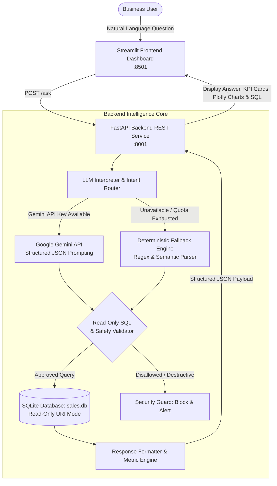

# Mini AI Business Intelligence Assistant
*RSG Graduate Engineer Trainee Selection Assignment*

An end-to-end, AI-powered Business Intelligence (BI) assistant that allows business users to query sales data in natural language and receive answers backed by deterministic SQLite queries, verified SQL scripts, supporting figures, and interactive visualizations.

---

## 🏗️ Architecture & System Design



### Component Breakdown
1. **Frontend (`frontend/dashboard.py`)**: Built with **Streamlit** and **Plotly**. Features quick-action example chips, natural language input, KPI metric cards, interactive bar/line charts, expandable supporting data tables, and an inspection card displaying the verified SQL query.
2. **Backend API (`app/main.py`)**: Built with **FastAPI**. Exposes `GET /health` for service health/database stats and `POST /ask` for query handling. Includes CORS middleware and Pydantic validation.
3. **Data Pipeline (`app/data_loader.py`)**: Reads `data/sales_data.csv`, applies deterministic data-cleaning and imputation rules, converts date strings to ISO-8601 (`YYYY-MM-DD`), computes line revenue, and stores data in SQLite (`data/sales.db`).
4. **Safety & SQL Execution Engine (`app/query_service.py`)**: Enforces read-only SQLite access (`mode=ro`). Validates SQL queries against forbidden destructive statements (`DROP`, `DELETE`, `UPDATE`, `INSERT`, `ALTER`, `ATTACH`, multi-statements).
5. **AI Interpretation Service (`app/llm_service.py`)**: Classifies user queries into structured analytical intents using Google Gemini. If the Gemini service is unavailable or its API quota is exhausted, the application activates the deterministic fallback engine to handle supported business questions without crashing.

---

## 📊 Revenue Calculation Formula & Business Rules

### 1. Revenue Definition (Net Realized Revenue)
$$ \text{Line Revenue} = (\text{Quantity} \times \text{Unit Price}) - \text{Discount Amount} $$
$$ \text{Total Net Revenue} = \sum_{\substack{\text{Status} = \text{'Completed'} \\ \text{Quantity} > 0}} \text{Line Revenue} $$

- **Discount Handling:** Four transactions (`TXN0004`, `TXN0012`, `TXN0022`, `TXN0028`) have discounts totaling ₹4,500.00. Discounts are subtracted from line item revenue to calculate net proceeds.
- **Cancelled/Returned Transactions:** `TXN0033` (Monitor, 2 units at ₹9,500 per unit, totaling ₹19,000 before discounts) has `Status = 'Returned'`. The record is retained in the database for auditability, but returned transactions are excluded from net revenue calculations, which include only completed transactions with a positive quantity.
- **Zero-Quantity Records:** `TXN0034` (Keyboard, Quantity = 0) represents a zero-quantity transaction. The record is retained in the database for auditability, but it contributes no units to sales volume and is excluded from valid completed-sales revenue calculations because its quantity is not greater than zero.
- **Missing Unit Price Imputation:** `TXN0051` (Laptop Stand, 5 units, `Unit_price = NaN`). All other 6 transactions for "Laptop Stand" in the catalog have a constant unit price of **₹1,200.00**. We impute this known catalog price ($5 \times 1,200 = \text{₹6,000.00}$) and flag the record with `is_imputed = 1` for auditability.
- **Zero and Unresolvable Unit Prices:** Missing unit prices for Laptop Stand transactions are imputed using the configured catalog price of ₹1,200 and flagged with `is_imputed = 1`. Any other missing unit prices that cannot be imputed are defaulted to ₹0 with a warning. Existing zero unit prices are retained as provided in the source data.

### 2. Baseline Figures from the Supplied Dataset

| Metric | Cleaned Baseline (Laptop Stand Imputed) | Un-imputed Alternative (Drop TXN0051) |
| :--- | :--- | :--- |
| **Total Net Revenue** | **₹1,445,200.00** | ₹1,439,200.00 |
| **Completed Orders** | **49** | 48 |
| **Total Units Sold** | **638 units** | 633 units |
| **Top Product** | **Monitor** (₹473,000.00, 50 units) | Monitor (₹473,000.00) |
| **Top Region** | **South** (₹411,200.00, 182 units) | South (₹411,200.00) |
| **Peak Month** | **2026-05** (₹318,500.00) | 2026-05 (₹318,500.00) |

---

## 🎯 Verification of the Five Core Assignment Questions

All five assignment questions are calculated directly using actual database queries:

| Question | Database Answer | Supporting Figures | Verified SQL Template |
| :--- | :--- | :--- | :--- |
| **1. What is the total revenue?** | **₹1,445,200.00** | 49 orders, 638 units, AOV: ₹29,493.88 | `SELECT ROUND(SUM((quantity * unit_price) - discount_amount), 2) AS total_revenue FROM sales WHERE status = 'Completed' AND quantity > 0;` |
| **2. Which product generated the highest revenue?** | **Monitor** (Electronics) | Revenue: ₹473,000.00 (32.7% share), 50 units sold | `SELECT product, category, ROUND(SUM((quantity * unit_price) - discount_amount), 2) AS revenue FROM sales WHERE status = 'Completed' AND quantity > 0 GROUP BY product ORDER BY revenue DESC;` |
| **3. What is the monthly revenue trend?** | Jan: ₹210,250 <br>Feb: ₹234,600 (+11.58%) <br>Mar: ₹223,900 (-4.56%) <br>Apr: ₹240,700 (+7.50%) <br>May: ₹318,500 (+32.32% peak) <br>Jun: ₹217,250 (-31.79%) | 6 months, peak in May 2026 (₹318,500.00) | `SELECT strftime('%Y-%m', order_date) AS month, ROUND(SUM((quantity * unit_price) - discount_amount), 2) AS revenue FROM sales WHERE status = 'Completed' AND quantity > 0 GROUP BY month ORDER BY month ASC;` |
| **4. Which region generated the highest sales?** | **South** | Revenue: ₹411,200.00 (28.5% share), 182 units, 13 orders | `SELECT region, ROUND(SUM((quantity * unit_price) - discount_amount), 2) AS revenue FROM sales WHERE status = 'Completed' AND quantity > 0 GROUP BY region ORDER BY revenue DESC;` |
| **5. How did revenue change between two months?** | e.g., May to June: Revenue decreased by **₹101,250.00 (-31.79%)** | May: ₹318,500.00 <br>Jun: ₹217,250.00 | `SELECT strftime('%Y-%m', order_date) AS month, ROUND(SUM((quantity * unit_price) - discount_amount), 2) AS revenue FROM sales WHERE status = 'Completed' AND quantity > 0 AND strftime('%Y-%m', order_date) IN ('2026-05', '2026-06') GROUP BY month ORDER BY month ASC;` |

---

## 🚀 Setup & Execution Instructions

### Prerequisites
- Python 3.10 or Python 3.11
- Git

### 1. Clone the Repository & Navigate to Workspace
```bash
git clone <your-github-repo-url>
cd "Mini ai assistant"
```

### 2. Set Up a Virtual Environment (Recommended)
```bash
python -m venv .venv

# On Windows (PowerShell):
.venv\Scripts\Activate.ps1

# On Linux / macOS:
source .venv/bin/activate
```

### 3. Install Dependencies
```bash
pip install -r requirements.txt
```

### 4. Configure Environment Variables (Optional)
Copy `.env.example` to `.env`:
```bash
cp .env.example .env
```
To enable live LLM query interpretation, add your API key:
```env
LLM_PROVIDER=gemini
GEMINI_API_KEY=your_gemini_api_key_here
```
> [!NOTE]
> If an API key is unavailable or an LLM request fails, the application falls back to its deterministic intent interpreter for supported business questions. The API response includes a source field indicating which interpretation mechanism was used.

### 5. Ingest the CSV into SQLite (Optional - runs automatically on backend launch)
```bash
python -m app.data_loader
```

### 6. Run the Application

#### Option A: Start the FastAPI Backend
In Terminal 1:
```bash
python run_api.py
```
*(Alternatively: `python -m uvicorn app.main:app --host 127.0.0.1 --port 8001`)*
- Interactive API Docs (Swagger UI): `http://127.0.0.1:8001/docs`
- Health check: `http://127.0.0.1:8001/health`

#### Option B: Start the Streamlit Frontend Dashboard
In Terminal 2:
```bash
python run_frontend.py
```
The dashboard will open automatically in your browser at `http://localhost:8501`.

---

## 🧪 Automated Testing

The project includes an automated test suite with **19 test cases** covering data ingestion, query calculations, SQL injection prevention, API endpoints, and natural-language intent parsing:

```bash
python -m pytest -v
```
Latest test result: 19 passed, 0 failed. One dependency deprecation warning was reported.

### Test Coverage Highlights:
- **`tests/test_data_loader.py`**: Validates the dataset row count (51), missing unit price imputation for `TXN0051` (Laptop Stand), detection of returned transactions and zero-quantity records, and net revenue calculations.
- **`tests/test_query_service.py`**: Verifies exact mathematical outputs for all 5 analytical questions and confirms that destructive SQL statements (`DROP`, `DELETE`, `UPDATE`, `INSERT`, `ALTER`, multi-statements) are blocked.
- **`tests/test_api.py`**: Tests `GET /health`, `POST /ask` with valid questions, edge-case month comparisons, empty inputs, and unsupported queries.
- **`tests/test_llm_service.py`**: Validates month entity extraction and fallback intent classification.

---

## 🔒 Security & Safety Controls

1. **Read-Only SQLite Connection:** Backend connections are opened using SQLite URI read-only mode (`file:sales.db?mode=ro`).
2. **SQL Safety Validator:** Ad-hoc and generated queries pass through `validate_sql_safety()`, which enforces `SELECT`/`WITH`-only execution and forbids destructive keywords and multi-statement queries.
3. **API Key Protection:** Secrets are never hardcoded. Keys are loaded from `.env` via `python-dotenv`, and `.gitignore` prevents `.env` and `*.db` files from being committed.
4. **Transparent Fallback Disclosure:** Every API response includes a `source` tag (`LLM` or `Deterministic Fallback Engine`) so users always know whether an LLM was used.

---

## ⚠️ Known Limitations
1. **Scope of Analytical Intents:** The assistant is calibrated for core business metrics (revenue, top products, monthly trends, regional breakdown, month comparisons). Complex multi-hop queries (e.g. "correlate retail discounts with customer churn") fall outside the scope.
2. **Static Sales Period:** The dataset covers January 2026 to June 2026. Date queries outside this window return ₹0.00.
3. **Single Table Schema:** The current model operates on a single denormalized `sales` table.
